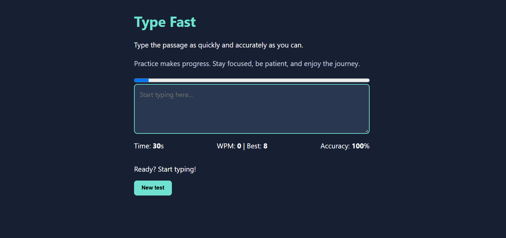

My project name is TypeFast. It is a small typing speed test. it tests your typing speed and how accurate u type.

HOW TO USE
Passages will be given on screen for you. start typing in the text box. timer starts automatically when you type. watch your words per min(WPM) it shows your accuracy.
click new test for new passage.

i built the game using html,css,javascript. i kept it small without any assets.

BUILDING
```
npm.install
node build.mjs

```
